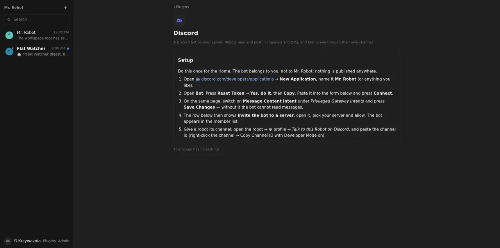

# 05: Discord bot plugin and channel

**Parent:** mr-robot-v1.5 (../mr-robot-v1.5.md) — stories cn-csae, cn-q259, cn-65gg, cn-y1ac

**What to build:** Guided bot setup (application, token into the vault, invite link); Discord tools (channels, read, send with files, react, DMs); a gateway connection held by a Durable Object; Discord as a channel of Mr. Robot: messages on a robot's channel or DM become wake-ups, replies and notifications return there; robot↔channel mapping in settings.

**Blocked by:** 01 Connector core, Plugins page, per-plugin settings rows

**Status:** in-progress

- [ ] Live: bot joins the owner's server; a message sent on a robot's channel reaches its conversation and the reply appears on Discord
- [ ] Notifications (not "finished") reach Discord when "Also send its own messages here" is on
- [ ] Gateway reconnects after a DO restart

## How it works

- **Setup:** the Discord plugin page has the guide: application, bot token, Message Content Intent, invite.
  - Connections → Discord → paste the token. It is checked with GET /users/@me and sealed in the vault.
  - The connection then offers **Invite the bot to a server**: the invite link uses the bot's id with the permissions to view, send, read history, react and attach.
- **Tools** (connectors/discord.ts): discord_me (with the invite link), discord_guilds, discord_channels (text channels, or the bot's DMs), discord_read_messages. With the write grant: discord_send_message (one Workspace file goes as multipart), discord_reply, discord_react, discord_dm.
- **Gateway** (connectors/discord-gateway.ts): a pure state machine. HELLO → IDENTIFY with the guild, message and content intents; heartbeats carry the last sequence; the session is stored from READY.
  - On op 7 it reconnects; an invalid session means identifying again. A person's message becomes a wake-up; bots, webhooks and empty messages are ignored.
  - The Home Durable Object holds the socket (home/discord.ts) and its alarm drives the heartbeats and the reconnect after a drop or a restart. The socket starts when a bot is connected and whenever a robot's channel changes.
- **Channel:** a robot's profile has *Talk to this Robot on Discord* with its channel id (robot↔channel mapping in its settings; the Home keeps the index).
  - Discord is on for a robot when it has a channel id. The old 'discord' entry in the notification channels does nothing.
  - A message in that channel wakes the robot. Each Discord message wakes the robot once.
  - **A reply goes back where the question came from.** The final reply of a Turn that a Discord message woke is posted in that channel as a Discord reply to the message. Interim replies stay in the app.
  - A Turn that a member started in the app answers in the app only. Nothing goes to Discord.
  - **Setting "Also send its own messages here"** (on by default): the final reply of a Turn that nobody asked for (a routine, a robot message, a takeover) and the notifications "needs you" and "blocked" go to the robot's channel. A "finished" notification never goes to Discord: the reply is already there. When the setting is off, Discord gets only replies to Discord messages.
  - **Long text:** a post of more than 2000 characters is split into several messages (at paragraphs, then lines). A code block that is cut is closed and opened again. Only the first message quotes the question.
  - **Tables:** Discord does not show Markdown tables, so a table is posted inside a code block.
  - **Decision:** a direct message to the bot reaches the bot owner's Mr. Robot, which needs no channel of its own, and his answer goes back to the DM; he can pass the message on to another robot. A message in a channel no robot owns wakes nobody.

## Verified

- **discord.test.ts:**
  - The gateway machine against recorded gateway payloads.
  - Every tool against recorded REST answers, including the multipart file and the write-grant gate; a 401 marks the connection "paste again".
  - Connect from a pasted token, with the invite link on the row.
  - End to end through the Robot DO: a channel message wakes the robot and only its final reply is posted, quoting the question; a duplicate wakes it once; a message from the app posts nothing; notify_owner posts to the channel; a routine posts its final reply only when the setting is on; a long reply arrives in several posts; a DM reaches Mr. Robot with the answer in the DM.
  - **discord-text.test.ts:** table fencing and message splitting (limit, fences, nothing lost).
- **Live (2026-10-08):** the Discord plugin page with the guide ().
- **Open, needs the owner's bot:** the bot joins his server, a message both ways, a notification, and the gateway coming back after a restart. The socket shell itself (outbound WebSocket from the Durable Object) has not run against Discord yet.

## Live, 2026-10-08 (with the owner, through Leash)
- **Setup:** the Discord application "Mr. Robot" (id 1557840219720519830) was created; the owner solved Discord's hCaptcha and its password check.
  - Message Content Intent is on.
  - **Decision:** Public Bot stays on. Discord refuses a private bot while the Installation tab has a default install link. A public bot can only be added by someone who has its link; it reads nothing unless it is in a server.
- **Connect:** the token went from the page straight into Connections → Discord and was checked by Discord. The row offers "Invite the bot to a server".
- **Server:** the owner had no server, so a private server "Mr. Robot" was created on his account. The bot was invited with exactly the six permissions; Mr. Robot (the robot) got #general (1557842506908041279).
- **Fixed live:**
  - The gateway never started: a Worker opens an outgoing WebSocket with fetch on an https:// address, not wss://. After the fix the bot shows Online.
  - A Turn failed for a robot holding two connector kinds: both mounted the same capability, so the prompt section "mr-robot:connector" was registered twice. Now there is one capability per kind. Regression test in connectors.test.ts.
- **Verified live:**
  - The gateway logs in.
  - After a deploy restarted the Durable Objects, the bot came back Online by itself, through the alarm.
  - Messages in #general arrive in Mr. Robot's conversation as Discord messages from "rk".
  - A post from Mr. Robot to #general works: his failure notice for check two appeared in the channel.
- **Not yet seen live:** an ordinary reply in #general. From check three on, every Turn failed with Anthropic 429 rate_limit_error ("would exceed your account's rate limit"), on the owner's Anthropic account. That is outside Mr. Robot.
